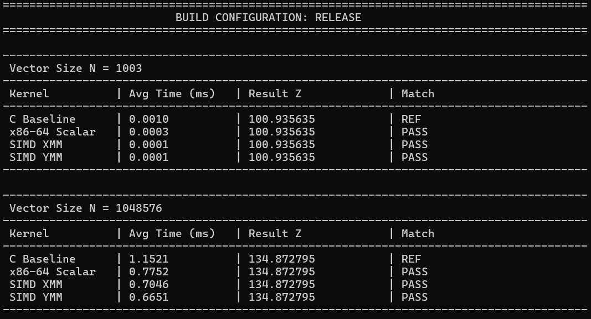
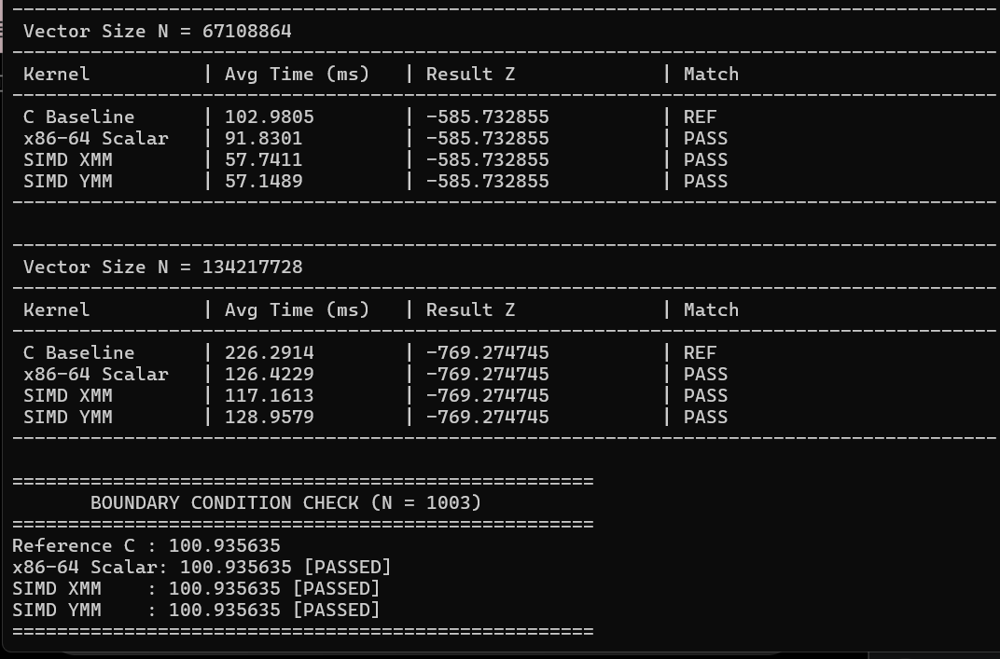

# CEPARCO: Deep Dive SIMD Project Term 1 AY 26-27
# Performance Report & Benchmark Analysis

> **Execution Environment Notes:**  
> * **Maximum Machine Capacity:** The maximum vector size supported by the test machine without encountering issues was **$N = 2^{27}$ ($134,217,728$ elements)**.  
> * **4 Accumulator Strategy:** All x86-64 assembly kernels (Scalar, SSE/XMM, and AVX/YMM) were implemented using **4 independent accumulators**.

## 1. Screenshot of results (with execution time and correctness check for all programs)

*Figure 1: Performance output showing execution times for C Baseline, x86-64 Scalar, SIMD XMM, and SIMD YMM across vector sizes up to $N = 2^{27}$.*

### b. Boundary Condition Check ($N = 1003$)

*Figure 2: Correctness verification all program results, confirming the exact match with Reference C output*

---

## 2. Comparative Execution Time

| Vector Size ($N$) | Case / Type | C Baseline (ms) | x86-64 Scalar (ms) | SIMD XMM (ms) | SIMD YMM (ms) | Speedup (YMM vs C) |
| :--- | :--- | :---: | :---: | :---: | :---: | :---: |
| **1,003** | Boundary Check | 0.0010 | 0.0003 | 0.0001 | 0.0001 | **10.00x** |
| **1,048,576** ($2^{20}$) | Medium Vector | 1.1521 | 0.7752 | 0.7046 | 0.6651 | **1.73x** |
| **67,108,864** ($2^{26}$) | Large Vector | 102.9805 | 91.8301 | 57.7411 | 57.1489 | **1.80x** |
| **134,217,728** ($2^{27}$) | Max Tested ($2^{27}$) | 226.2914 | 126.4229 | 117.1613 | 128.9579 | **1.75x** |

---

## 3. Performance Analysis

### Test 1

### Test 2

---

# 4. Implementation Details & Unique Methodology

* test

---

## 5. Problems Encountered & Solutions

* test